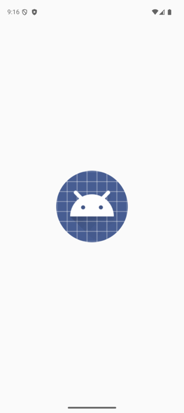
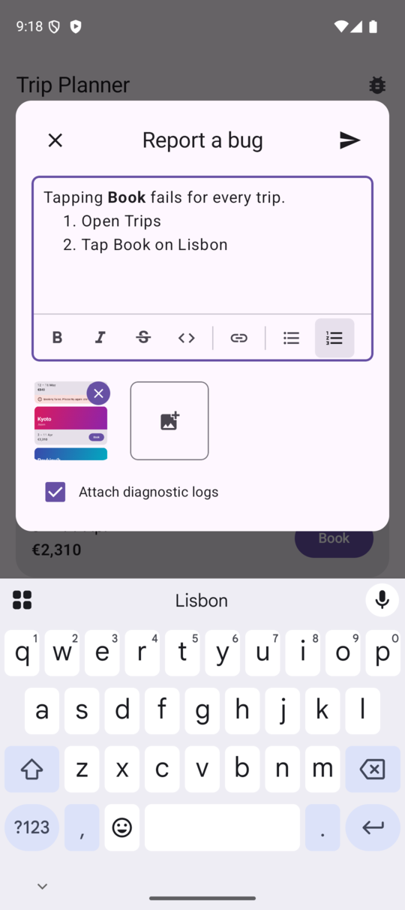
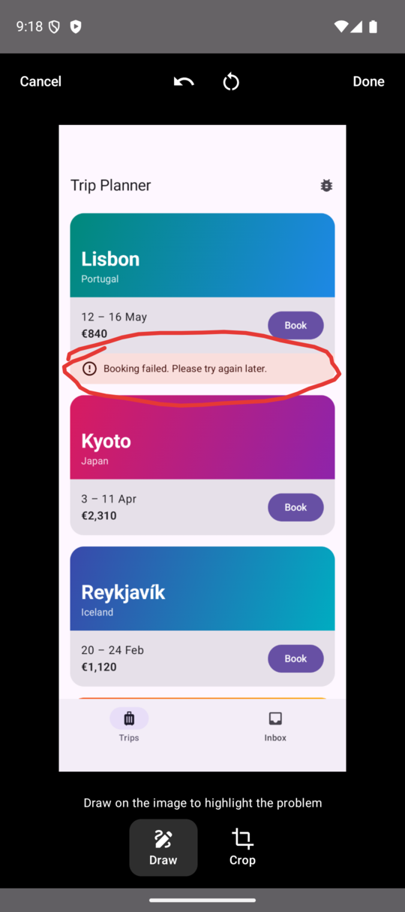
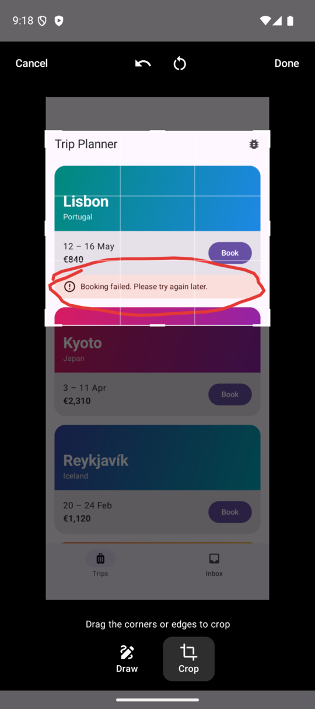
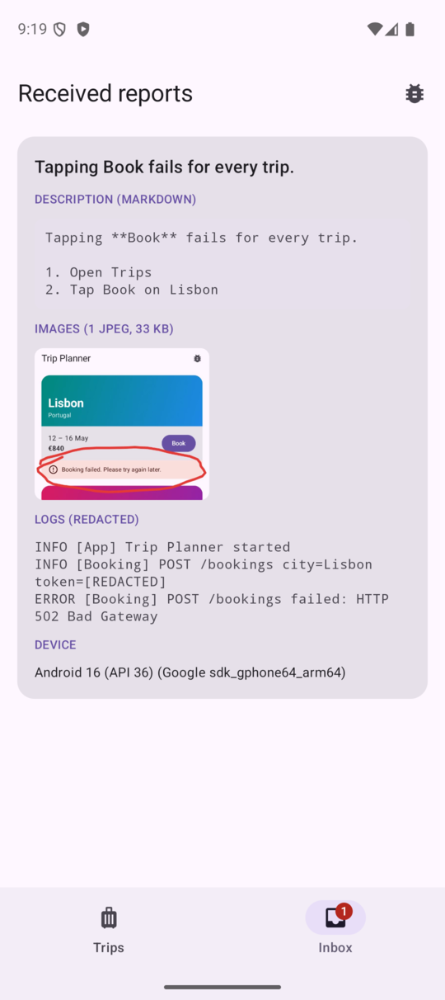
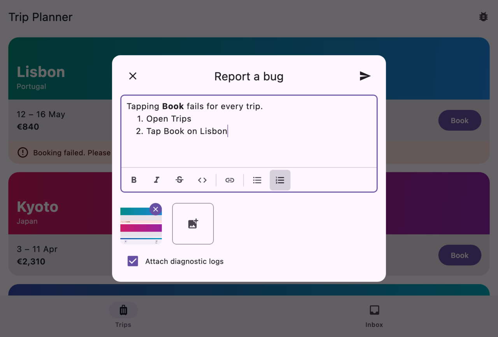
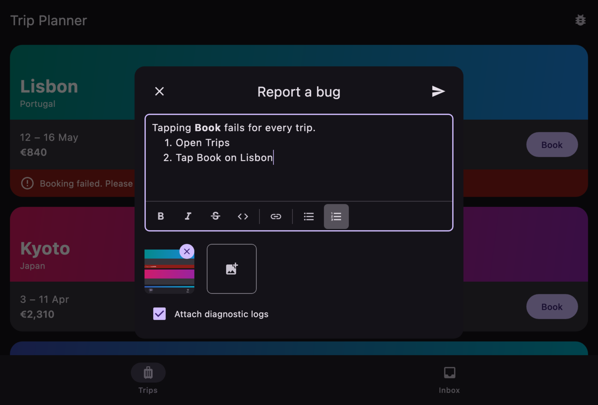

# KMP Bug Report

Drop-in in-app bug reporting for **Compose Multiplatform** — Android, iOS, desktop (JVM) and web
(Wasm and JS).

<p align="center">
  
</p>

- **Screenshot capture** of your app's content when the report opens. On iOS and Android 14+ the
  form also opens by itself when the user takes a system screenshot.
- **Markup and crop editor**: draw on an image to circle the problem, crop away what doesn't matter
  (or what's private), undo any step.
- **Markdown description** with a formatting toolbar — bold, italic, strikethrough, inline code,
  links, bulleted and numbered lists (Cmd/Ctrl+B, I, K; Cmd/Ctrl+Enter sends).
- **More images** from the platform picker (Photo Picker, PHPicker, file dialog, `<input type=file>`).
- **Diagnostic logs** from a bounded, self-redacting buffer, snapshotted when the report opens and
  attached only if the user leaves the box ticked.
- **Bring your own transport.** You get a `BugReport`; send it anywhere. A Ktor multipart sender is
  included.
- Translated into English, Czech, German, Polish and Ukrainian.

> **Status:** pre-release. `0.1.0` is not on Maven Central yet; until it is, build from source with
> `includeBuild` (see [Build](#build)).

## See it

Recorded from the [sample app](#sample-app) on an Android 16 emulator: a booking fails, the user
takes a screenshot, and the form opens with that screen attached.

| Describe it in Markdown | Circle the problem | Crop to what matters | What your sender gets |
|:---:|:---:|:---:|:---:|
|  |  |  |  |

The same UI on desktop, following the app's light or dark theme:

<p align="center">
  
  
</p>

## Install

```kotlin
// build.gradle.kts of your shared module
kotlin {
    sourceSets {
        commonMain.dependencies {
            implementation("io.github.antonudovychenko:bugreport:0.1.0")
            // Optional: ready-made multipart sender for a Ktor HttpClient.
            implementation("io.github.antonudovychenko:bugreport-ktor:0.1.0")
        }
    }
}
```

Requires Kotlin 2.3+, Compose Multiplatform 1.11+, Android minSdk 24.

## Use

Wrap your app's content in `BugReportHost`, inside your `MaterialTheme`:

```kotlin
val bugReports = rememberBugReportController()

MaterialTheme {
    BugReportHost(
        sender = KtorBugReportSender(httpClient, "https://api.example.com/bug-reports"),
        controller = bugReports,
        logs = { logBuffer.export() },
        metadata = { mapOf("buildVersion" to BuildConfig.VERSION_NAME) },
    ) {
        AppContent(onReportBug = bugReports::open)
    }
}
```

`BugReportController` is a plain object, so it can also live in your DI container and be opened
from anywhere — a menu item, a shake detector, a debug drawer.

### Send it anywhere

```kotlin
val sender = BugReportSender { report ->
    // report.description          — Markdown
    // report.plainTextDescription — the same, formatting removed
    // report.images               — JPEGs with markup and crop baked in
    // report.logs                 — the log snapshot, or null
    // report.device               — e.g. "Android 15 (API 35) (Google Pixel 9)"
    // report.metadata             — whatever you passed to BugReportHost
    myApi.fileIssue(report)
}
```

Throw to report a failure: the draft stays open so nothing the user typed is lost. Throw
`BugReportSendException("You've sent a lot of reports — try again in an hour")` to show your own
message instead of the generic one.

The Ktor sender posts `multipart/form-data` with a `description` field, a `device` field, one field
per metadata entry, one `screenshot` file part per image and a `logs` file part. Rename or drop any
part with `MultipartBugReportFormat`, or call `HttpClient.submitBugReport(url, report, format)`
from your own sender when the URL or client is only known at send time.

### Diagnostic logs

```kotlin
val logBuffer = DiagnosticLogBuffer() // 1 MiB, oldest lines dropped first

// From your logger:
logBuffer.append(level = "WARN", tag = "Sync", message = "push failed", throwable = e)
```

Bearer tokens, JWTs, e-mail addresses, credential-looking query parameters and
`password=`/`token=`/`secret=`/`api_key=` pairs are redacted before a line is stored. Add your own
rules with `DiagnosticLogBuffer(redact = { redactDiagnosticText(it).replace(myPattern, "[X]") })`.

### Configure

```kotlin
BugReportConfig(
    maxImages = 4,
    openOnSystemScreenshot = true,   // iOS, Android 14+
    captureScreenshotOnOpen = true,
    allowImagePicking = true,
    maxImageDimension = 1600,        // keeps JPEG encoding fast, uploads small
    jpegQuality = 80,
    penColor = Color(0xFFE53935),
    penWidth = 4.dp,
    showSuccessDialog = true,
    attachLogsByDefault = true,
)
```

### The editor on its own

`ImageMarkupEditor(image, onDone, onCancel)` is public and depends on nothing else here — use it
anywhere you want a user to annotate or crop an `ImageBitmap`.

## Sample app

[`sample/`](sample) is a small travel app whose **Book** button always fails — report it, then open
**Inbox** to see exactly what a `BugReportSender` receives: the Markdown, the edited images, the
redacted logs and the device.

```bash
./gradlew :sample:run                              # desktop
./gradlew :sample:wasmJsBrowserDevelopmentRun      # web, opens a browser
./gradlew :sample-android:installDebug             # Android device or emulator
```

On Android 14+ take a screenshot (power + volume down, or `adb shell input keyevent 120` on an
emulator) to open the form without touching the app's own button.

## Platform notes

| | Opens on system screenshot | Image picker |
|---|---|---|
| Android | API 34+ (`Activity.ScreenCaptureCallback`; the library declares `DETECT_SCREEN_CAPTURE`) | Photo Picker |
| iOS | Yes (`UIApplicationUserDidTakeScreenshotNotification`) | PHPicker; HEIC is converted to JPEG |
| Desktop | No — open it from a menu | AWT file dialog |
| Web | No — open it from a menu | `<input type=file>` |

The capture is of the content inside `BugReportHost` — not other windows, dialogs or system UI.
On web and desktop the content is routed through a graphics layer only for the two frames a capture
takes, because a permanent one breaks input there
([compose-multiplatform#3230](https://github.com/JetBrains/compose-multiplatform/issues/3230)).

## Build

To use an unreleased checkout from your app, add `includeBuild("path/to/kmp-bugreport")` to its
`settings.gradle.kts` and depend on the coordinates without a version.

```bash
./gradlew jvmTest                     # the shared tests, on the JVM
./gradlew compileKotlinIosSimulatorArm64 compileKotlinWasmJs compileKotlinJs compileAndroidMain
```

The shared tests compile for every target; the browser test runners are disabled so no headless
browser is needed.

## Publishing

Publishing uses [com.vanniktech.maven.publish](https://vanniktech.github.io/gradle-maven-publish-plugin/)
from [.github/workflows/publish.yml](.github/workflows/publish.yml):

1. Set `VERSION_NAME` in `gradle.properties` to the release version (no `-SNAPSHOT`).
2. Push a matching tag, e.g. `v0.1.0`. The workflow tests, builds every target on macOS, signs and
   uploads to the Central Portal.
3. Review the deployment at [central.sonatype.com](https://central.sonatype.com) and press
   **Publish**.

The workflow needs the repository secrets `MAVEN_CENTRAL_USERNAME`, `MAVEN_CENTRAL_PASSWORD` (a
Central Portal user token), `SIGNING_KEY` (an ASCII-armoured GPG private key) and
`SIGNING_KEY_PASSWORD`.

## License

Apache License 2.0 — see [LICENSE](LICENSE).
